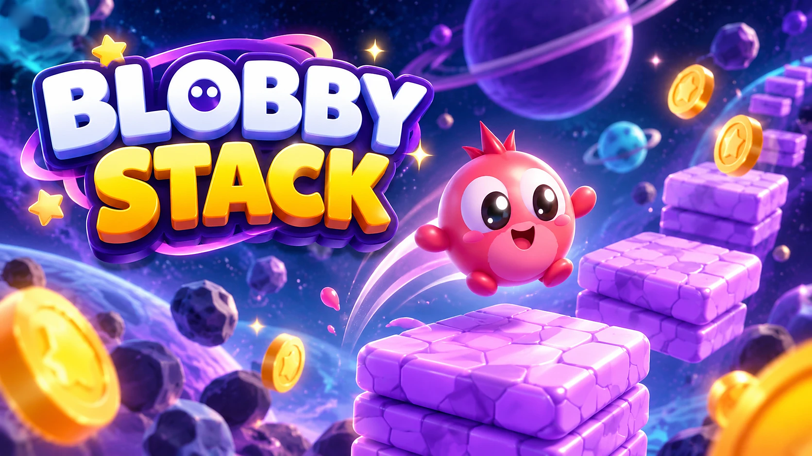
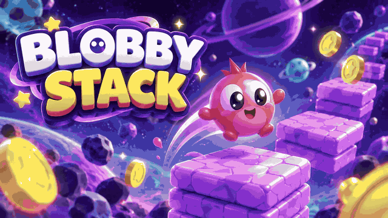
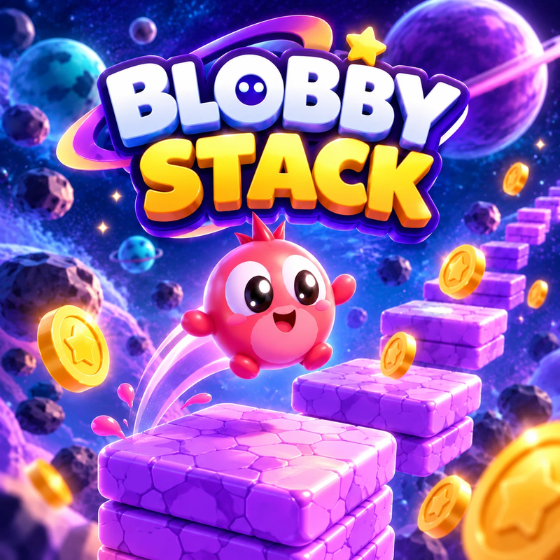
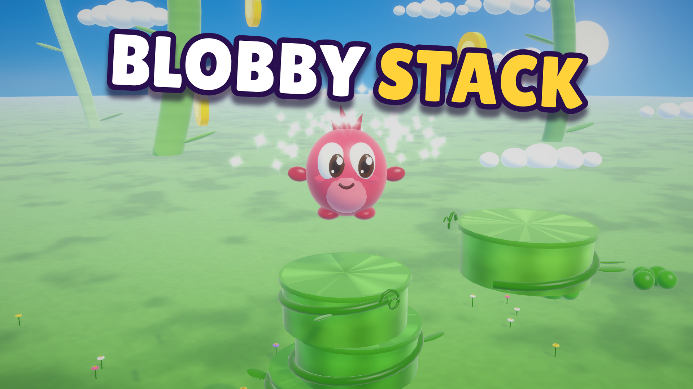

# Blobby Stack



[**Play free in your browser on itch.io**](https://bluelolipop1.itch.io/blobby-stack)

A cute one-tap stacking game for the web. Blocks slide in from the side: tap at just the right moment to hop
over them and land on top. Nail the timing for a PERFECT landing and chain bonus points, but jump too early or
too late and you get bumped off the tower.

Built with Unity 6 (URP, WebGL). Every block, character, world and UI element is generated procedurally in code;
the only imported art is the cover set.

## Features

- One-button controls: Space, W, Up arrow, click or tap
- 7 worlds with their own blocks and scenery: Cosmos, Beanstalk, Haunted Hill, Sunset Farm, Hot Kitchen,
  Golden Castle, Neon City
- 7 characters to unlock with coins
- Perfect-timing streaks worth up to 3 points per block
- Daily reward and a new Daily Tower challenge every day
- Local 2 Player race on one keyboard or one screen
- Pause (button, Esc or P), desktop and mobile, portrait and landscape

## Trailer



Full quality: [landscape](Submission/trailer/trailer-landscape.mp4) and [portrait](Submission/trailer/trailer-portrait.mp4).

## Covers

The `art-*` set is the one used on the portals.

| Landscape (1920×1080) | Portrait (800×1200) | Square (800×800) |
|---|---|---|
|  |  |  |

## Worlds

| Cosmos | Sunset Farm | Neon City | Beanstalk |
|---|---|---|---|
|  |  |  |  |

All cover files, including the sets for each portal, are in [`Submission/covers/`](Submission/covers),
[`Submission/covers/gamedistribution/`](Submission/covers/gamedistribution) and
[`Submission/itch/`](Submission/itch).

## Requirements

- Unity **6000.4.5f1** with the WebGL build module
- Python 3 with Pillow, only for the cover scripts in `Tools/`

## Build

One project builds for several web portals. Each build contains only its own portal's SDK. Close the Unity
Editor first (a headless build can't open a project that is already open).

```powershell
$unity = "C:\Program Files\Unity\Hub\Editor\6000.4.5f1\Editor\Unity.exe"
& $unity -batchmode -projectPath . -buildTarget WebGL -executeMethod StackJump.EditorTools.StackJumpSetup.<Method> -logFile Logs\build.log
```

| `<Method>` | Output | For |
|---|---|---|
| `BuildRelease` | `Builds/WebGL` | CrazyGames Basic Launch (no ads) |
| `BuildReleaseFull` | `Builds/WebGL-full` | CrazyGames Full Launch (ads) |
| `BuildPoki` | `Builds/Poki` | Poki |
| `BuildGameDistribution` | `Builds/GameDistribution` | GameDistribution |
| `BuildItch` | `Builds/Itch` | itch.io (no SDK, no ads); page text and images in [`Submission/itch/`](Submission/itch) |
| `BuildDev` | `Builds/WebGL-dev` | Local testing: uncompressed, with ads |

Serve a build locally with any static server, for example
`python -m http.server 8765 --directory Builds/WebGL-dev`, then open http://localhost:8765. Portal SDKs only
serve ads on their own sites; on localhost the game runs without them.

For GameDistribution, put your game ID in `Submission/gamedistribution/game-id.txt` (or set `SJ_GD_GAME_ID`)
before building. Builds are about 8 MB with Brotli compression.

## How the portals are handled

`Assets/StackJump/Scripts/Platform.cs` is the only code that talks to a portal SDK; the rest of the game only
sees its API. The portal is chosen by a scripting define (`SJ_POKI`, `SJ_GD`, or neither for CrazyGames, plus
`SJ_ADS` for ads), and the build methods also switch the matching JavaScript bridge and WebGL page template on
and off. The CrazyGames SDK has a site-lock that crashes the game on other domains, so the other builds leave
it out completely (assembly define constraints, plugin toggles, and its `Resources` folder parked during the
build).

Each portal's rules are followed in the game itself: when ads may play, how rewarded buttons look, pause
behaviour, and when gameplay start and stop are reported. The details and each portal's submission steps are in
[`Submission/SUBMISSION.md`](Submission/SUBMISSION.md) (CrazyGames) and
[`Submission/OTHER-PORTALS.md`](Submission/OTHER-PORTALS.md) (Poki and GameDistribution).

## Project layout

| Path | What's in it |
|---|---|
| `Assets/StackJump/Scripts` | Game code: lanes, tower, characters, UI, themes, economy, platform layer |
| `Assets/StackJump/Shaders` | Toon, unlit and sky shaders |
| `Assets/StackJump/Editor` | Project setup and the portal build methods |
| `Assets/WebGLTemplates` | Page templates for the default build, Poki and GameDistribution |
| `Assets/CrazySDK`, `Assets/PokiSDK` | The portals' official SDKs (see below) |
| `Tools/` | Cover scripts (`prepare_covers.py`, `compose_covers.py`, `gd_covers.py`) |
| `Submission/` | Store texts, covers, trailers and QA checklists |

## Third-party code and assets

- **CrazyGames SDK** and **Poki Unity SDK**: included unmodified in `Assets/CrazySDK` and `Assets/PokiSDK`
  under their own terms; they are not covered by this project's license.
- **Lilita One** font by Juan Montoreano: SIL Open Font License, see `Assets/StackJump/Licenses`.

## License

No license has been chosen yet, so all rights are reserved by the author.
