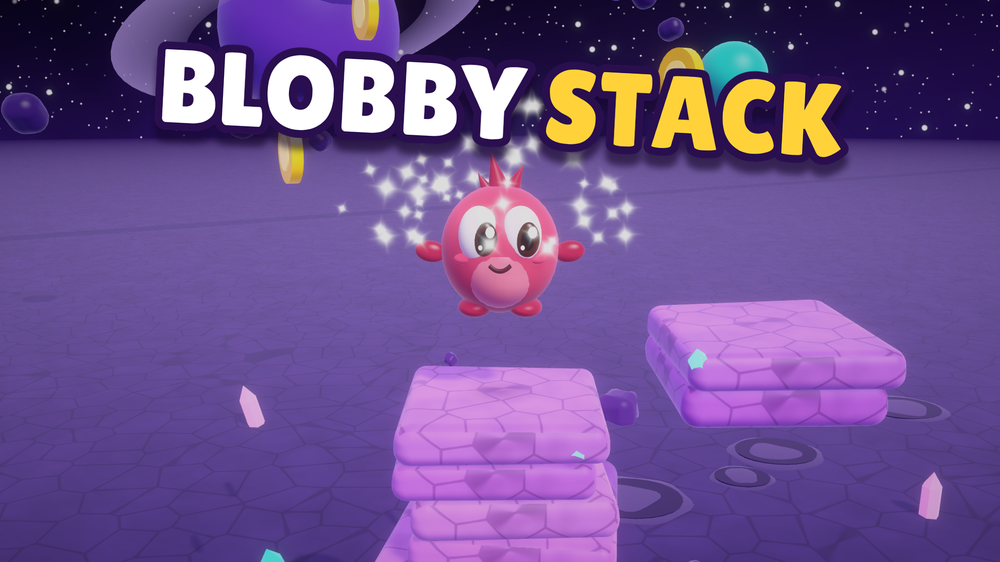
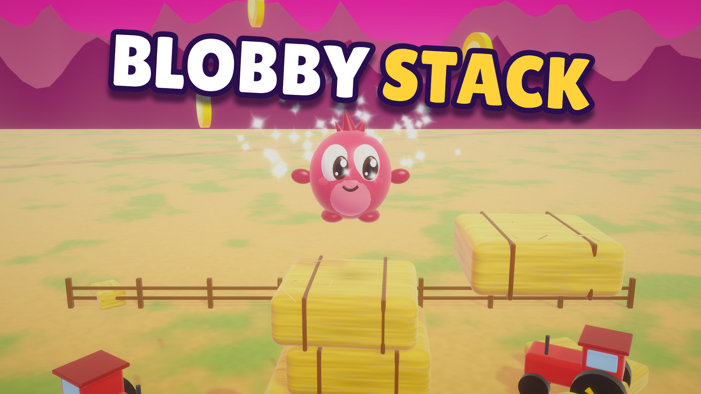
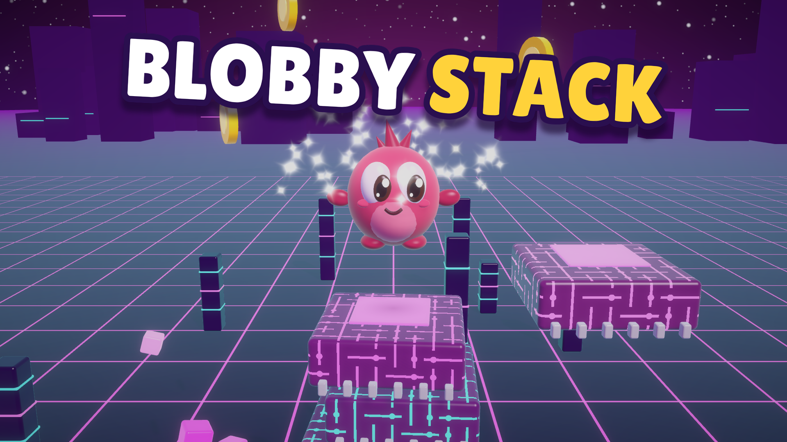
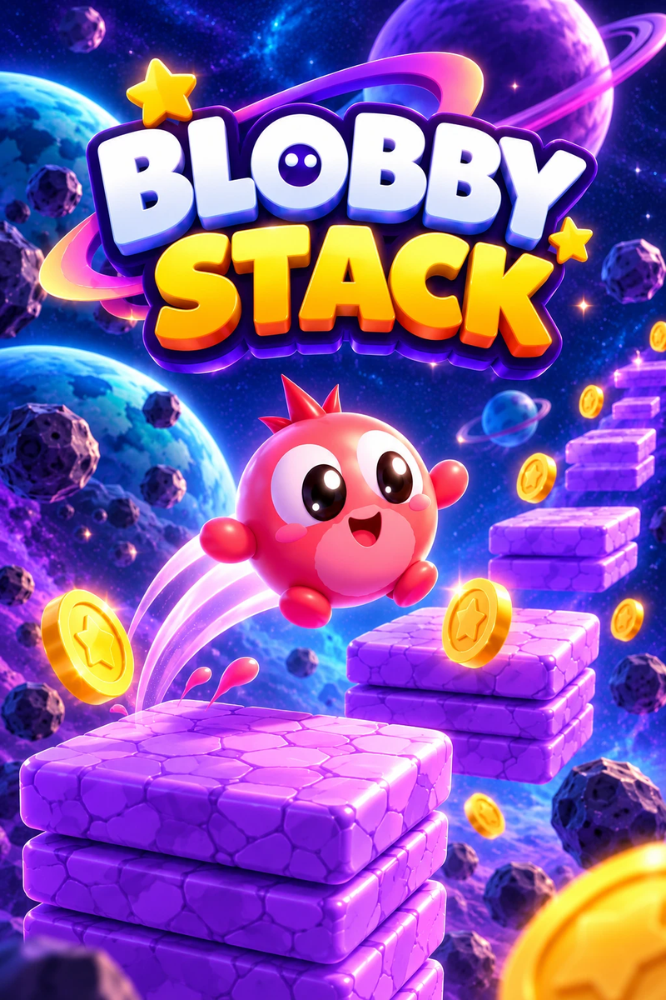

<p align="center">
  
</p>
<p align="center">
  
</p>
<p align="center">
  <a href="https://bluelolipop1.itch.io/blobby-stack"></a>
</p>
<p align="center"><sub>Free in your browser · no download · desktop &amp; mobile, portrait &amp; landscape</sub></p>
<p align="center">
  
  
  
  
  
  
</p>
<p align="center">
   TAP AT THE PERFECT MOMENT / > PERFECT! x3 STREAK! / > HOW HIGH CAN YOU STACK?" />
</p>

---

<h2 align="center">🎮 GAMEPLAY</h2>

<p align="center">
  
</p>
<p align="center">Blocks slide in from the side: tap at just the right moment to hop over them and land on top.<br/>Nail the timing for a <b>PERFECT</b> landing and chain bonus points, but jump too early or too late and you get bumped off the tower.</p>
<p align="center"><sub>Full-quality trailers: <a href="Submission/trailer/trailer-landscape.mp4">landscape</a> · <a href="Submission/trailer/trailer-portrait.mp4">portrait</a></sub></p>

<p align="center">
  
</p>

---

<h2 align="center">🌌 SEVEN WORLDS</h2>

<p align="center">
  
  
  <br/><sub>🌌 Cosmos &nbsp;·&nbsp; 🌱 Beanstalk</sub>
</p>
<p align="center">
  
  
  <br/><sub>🌅 Sunset Farm &nbsp;·&nbsp; 🌃 Neon City</sub>
</p>
<p align="center"><sub>Plus Haunted Hill, Hot Kitchen and Golden Castle</sub></p>

---

<h2 align="center">🕹️ CONTROLS</h2>

| Action | Keyboard | Mouse / touch |
|---|---|---|
| Jump | Space, W or Up arrow | Click or tap |
| Pause | Esc or P | Pause button |

---

<h2 align="center">⚙️ UNDER THE HOOD</h2>

<p align="center">
  
</p>

---

<h2 align="center">🛠️ FOR DEVELOPERS</h2>


<details>
<summary><b>🛠️ For developers: covers, requirements, portal builds and project layout</b></summary>

### Covers

The `art-*` set is the one used on the portals.

| Landscape (1920×1080) | Portrait (800×1200) | Square (800×800) |
|---|---|---|
|  |  |  |

### Requirements

- Unity **6000.4.5f1** with the WebGL build module
- Python 3 with Pillow, only for the cover scripts in `Tools/`

### Build

One project builds for several web portals. Each build contains only its own portal's SDK. Close the Unity
Editor first (a headless build can't open a project that is already open).

```powershell
$unity = "C:\Program Files\Unity\Hub\Editor\6000.4.5f1\Editor\Unity.exe"
& $unity -batchmode -projectPath . -buildTarget WebGL -executeMethod StackJump.EditorTools.StackJumpSetup.<Method> -logFile Logs\build.log
```

| `<Method>` | Output | For |
|---|---|---|
| `BuildRelease` | `Builds/WebGL` | CrazyGames Basic Launch (no ads) |
| `BuildReleaseFull` | `Builds/WebGL-full` | CrazyGames Full Launch (ads) |
| `BuildPoki` | `Builds/Poki` | Poki |
| `BuildGameDistribution` | `Builds/GameDistribution` | GameDistribution |
| `BuildItch` | `Builds/Itch` | itch.io (no SDK, no ads); page text and images in [`Submission/itch/`](Submission/itch) |
| `BuildDev` | `Builds/WebGL-dev` | Local testing: uncompressed, with ads |

Serve a build locally with any static server, for example
`python -m http.server 8765 --directory Builds/WebGL-dev`, then open http://localhost:8765. Portal SDKs only
serve ads on their own sites; on localhost the game runs without them.

For GameDistribution, put your game ID in `Submission/gamedistribution/game-id.txt` (or set `SJ_GD_GAME_ID`)
before building. Builds are about 8 MB with Brotli compression.

### How the portals are handled

`Assets/StackJump/Scripts/Platform.cs` is the only code that talks to a portal SDK; the rest of the game only
sees its API. The portal is chosen by a scripting define (`SJ_POKI`, `SJ_GD`, or neither for CrazyGames, plus
`SJ_ADS` for ads), and the build methods also switch the matching JavaScript bridge and WebGL page template on
and off. The CrazyGames SDK has a site-lock that crashes the game on other domains, so the other builds leave
it out completely (assembly define constraints, plugin toggles, and its `Resources` folder parked during the
build).

Each portal's rules are followed in the game itself: when ads may play, how rewarded buttons look, pause
behaviour, and when gameplay start and stop are reported. The details and each portal's submission steps are in
[`Submission/SUBMISSION.md`](Submission/SUBMISSION.md) (CrazyGames) and
[`Submission/OTHER-PORTALS.md`](Submission/OTHER-PORTALS.md) (Poki and GameDistribution).

### Project layout

| Path | What's in it |
|---|---|
| `Assets/StackJump/Scripts` | Game code: lanes, tower, characters, UI, themes, economy, platform layer |
| `Assets/StackJump/Shaders` | Toon, unlit and sky shaders |
| `Assets/StackJump/Editor` | Project setup and the portal build methods |
| `Assets/WebGLTemplates` | Page templates for the default build, Poki and GameDistribution |
| `Assets/CrazySDK`, `Assets/PokiSDK` | The portals' official SDKs (see below) |
| `Tools/` | Cover scripts (`prepare_covers.py`, `compose_covers.py`, `gd_covers.py`) |
| `Submission/` | Store texts, covers, trailers and QA checklists |

### Third-party code and assets

- **CrazyGames SDK** and **Poki Unity SDK**: included unmodified in `Assets/CrazySDK` and `Assets/PokiSDK`
  under their own terms; they are not covered by this project's license.
- **Lilita One** font by Juan Montoreano: SIL Open Font License, see `Assets/StackJump/Licenses`.

</details>

### 📄 License

No license has been chosen yet, so all rights are reserved by the author.

---

<p align="center">
  <b>Made with ❤️ and 🫧 by <a href="https://github.com/vishwaMoger">Vishwa Moger</a></b><br/>
  <sub>Game Developer · 3+ years · Bangalore, India · <a href="https://bluelolipop1.itch.io">more games on itch.io</a> · <a href="https://vishwa-moger.vercel.app">portfolio</a></sub>
</p>


